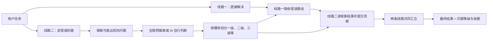

# DualPath

一个按照“双线路”原始思路构建的 AI 任务执行框架：

- **线路一：直接解决问题。**
- **线路二：走“错误的路”**，探索执行项目时可能出现的问题，并推演每条错误路线如何发生、造成什么结果。
- 两条线路从任务开始时并行推进。
- 每个问题按出现概率分类，**最高概率的问题固定为一级**，其余按概率依次分级；相同概率同级。
- 概率优先依据互联网资料；没有资料时由 AI 自行判断，并明确标注。
- 问题、概率、等级、判断理由和资料向用户展示。
- 两条线路最后分别吸收对方成果，再共同汇合完成最终任务。

项目目前处于 MVP 阶段，使用 Python，内置 **DeepSeek**，同时支持其他 OpenAI 兼容模型接口。

## 执行流程



## 安装

要求 Python 3.10 或更高版本。

```bash
git clone https://github.com/laozidabo/dualpath.git
cd dualpath
python -m pip install -e .
```

开发安装：

```bash
python -m pip install -e ".[dev]"
pytest
```

## 使用 DeepSeek

设置 API Key：

```bash
export DEEPSEEK_API_KEY="你的 DeepSeek API Key"
```

运行任务：

```bash
dualpath run "为一个开源 Python 项目设计并实现命令行待办事项管理器" \
  --provider deepseek \
  --model deepseek-v4-flash \
  --json result.json \
  --markdown result.md
```

`--provider deepseek` 和上述模型名是默认值，因此也可以简写为：

```bash
dualpath run "你的任务"
```

可以通过 `DEEPSEEK_MODEL`、`DEEPSEEK_BASE_URL` 或对应命令行参数覆盖默认配置。模型名称如有调整，以 [DeepSeek 官方 API 文档](https://api-docs.deepseek.com/) 为准。

Windows PowerShell：

```powershell
$env:DEEPSEEK_API_KEY="你的 DeepSeek API Key"
dualpath run "你的任务"
```

## 使用其他 OpenAI 兼容接口

```bash
export DUALPATH_API_KEY="你的 API Key"
export DUALPATH_BASE_URL="https://你的接口地址/v1"
export DUALPATH_MODEL="模型名称"

dualpath run "你的任务" --provider openai-compatible
```

也支持 `OPENAI_API_KEY`、`OPENAI_BASE_URL` 和 `OPENAI_MODEL`。

## 命令行参数

```text
--provider             deepseek 或 openai-compatible
--model                模型名称
--api-key              API Key，推荐使用环境变量代替
--base-url             覆盖 API 地址
--max-problems         错误线路最多探索的问题数，默认 5
--search-results       每个问题最多使用的搜索结果数，默认 4
--no-search            关闭搜索，所有概率由 AI 自行判断
--json PATH            保存结构化完整记录
--markdown PATH        保存可阅读的完整记录
--quiet                隐藏过程信息，只输出最终结果
```

## 输出内容

控制台会实时展示两条线路的状态，并在错误线路完成概率判断后展示：

```text
线路二发现的问题（按出现概率排序）：
  1级｜80%｜问题甲｜互联网资料
  2级｜45%｜问题乙｜互联网资料与AI判断
  3级｜20%｜问题丙｜AI自行判断（无检索资料）
```

Markdown 和 JSON 记录还包括：

- 每条错误路线的具体推演；
- 概率判断理由；
- 实际搜索得到的标题、网址和摘要；
- 线路一原始结果；
- 线路二原始结果；
- 双方各自的汇聚贡献；
- 最终共同结果。

概率分级采用密集排序：概率从高到低排列，最高概率为一级，下一个不同概率为二级，依此类推；相同概率为同一级。

## 作为 Python 库使用

```python
import asyncio
from dualpath import DualPath
from dualpath.llm import DeepSeekModel
from dualpath.search import DuckDuckGoSearch


async def main():
    engine = DualPath(
        model=DeepSeekModel(),
        search=DuckDuckGoSearch(),
        max_problems=5,
    )
    result = await engine.run("你的任务")
    print(result.final_output)
    print(result.to_markdown())


asyncio.run(main())
```

## 概率与资料标记

每个问题都有 `basis` 字段：

| 值 | 含义 |
| --- | --- |
| `internet` | 依据互联网资料判断 |
| `mixed` | 结合互联网资料与当前任务情况判断 |
| `model_judgment` | 没有可用检索资料，由 AI 自行判断 |

搜索失败时也归入 `model_judgment`，并在判断理由中注明。框架只把搜索接口实际返回的资料写入 `evidence`，不让模型自行生成网址或证据。

这里的概率是模型针对当前任务作出的估计，不代表经过统计校准的真实频率；原始估计值和依据会完整保留，便于检查和改进。

## 项目结构

```text
src/dualpath/
├── orchestrator.py   # 两线并行与最终汇合
├── paths.py          # 直接线路、错误线路、共同汇聚
├── models.py         # 问题、资料、概率等级与执行结果
├── llm.py            # DeepSeek 与 OpenAI 兼容接口
├── search.py         # 互联网搜索接口
├── prompts.py        # 两条线路的提示词
├── reporting.py      # 用户展示
└── cli.py            # 命令行入口
```

## 开源协作

本项目使用 MIT License。贡献方式见 [CONTRIBUTING.md](CONTRIBUTING.md)。
